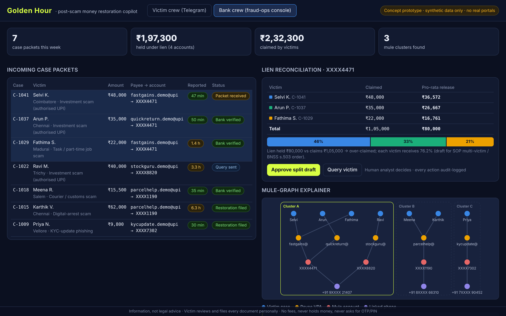
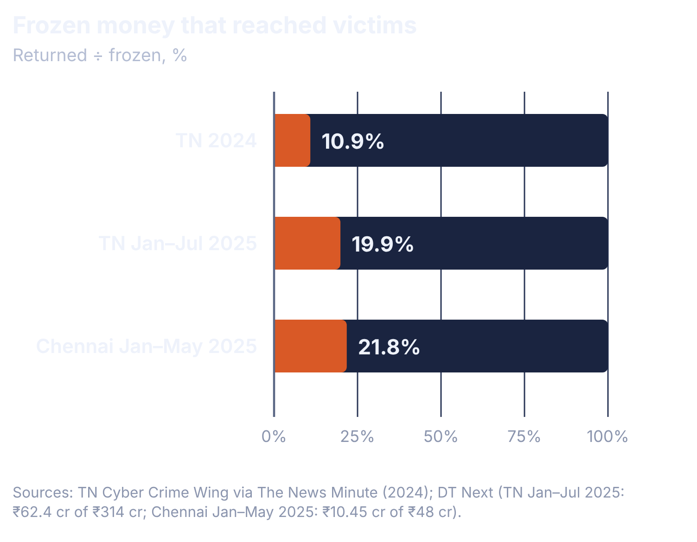
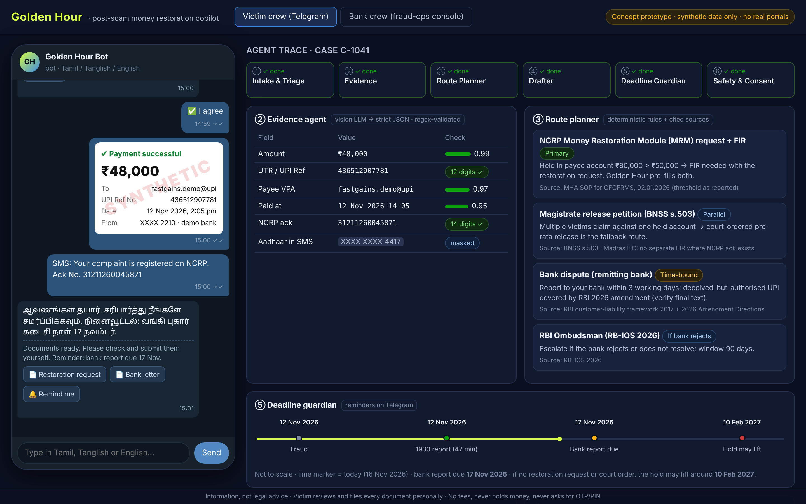
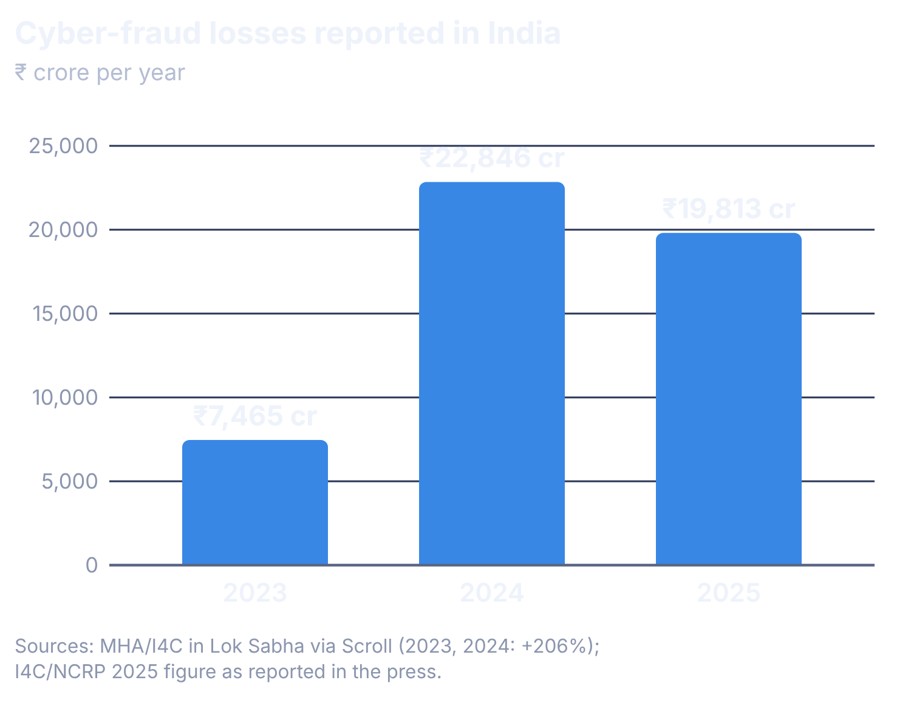

# Golden Hour

**A multi-agent copilot that turns frozen scam money into filed refund claims.**
FinTech track · K! Hacks 4.0 (CEG Tech Forum, Anna University) · Team Golden Hour, Chennai Institute of Technology



> **Concept prototype for the Round 1 idea submission.** It runs entirely on synthetic data. It does not connect to any real bank, police or government portal. The finals build will be developed during the 24-hour hackathon, as the rules require.

## The problem

When a scam is reported quickly, the money often gets frozen. It rarely comes back.


- **Tamil Nadu 2024:** ₹1,673 cr lost, ₹772 cr frozen, about ₹84 cr returned. That is roughly 11% of the frozen money. *(TN Cyber Crime Wing, via The News Minute and DT Next)*
- **Chennai, Jan–May 2025:** ₹48 cr frozen, ₹10.45 cr returned "after legal processes". *(DT Next)*
- **The victim has to start the restoration.** That means 4+ separate channels, most of them English-first:
  - the MHA SOP (Jan 2026) and the NCRP Money Restoration Module
  - a magistrate petition under BNSS s.503
  - a bank dispute
  - the RBI Ombudsman
- **There is a deadline.** If no restoration request or court order arrives, banks can lift the hold. Reports put this at about 90 days.



## The solution

Two crews of agents share one case packet.

**Victim crew** (Telegram, in Tamil, Tanglish or English, voice or text):

1. **Intake & Triage** – speech-to-text in Tamil and Tanglish, then a reply in the victim's language.
2. **Evidence** – turns UPI screenshots, bank SMS and the NCRP acknowledgement into strict JSON. It validates the 12-digit UTR and the 14-digit acknowledgement number, and masks Aadhaar and PAN.
3. **Route Planner** – uses deterministic rules with cited sources to pick the right official route: MRM request, BNSS s.503 petition, bank dispute, or RB-IOS 2026 Ombudsman.
4. **Drafter** – pre-fills the forms, petition and letters, then reads them back in Tamil. The victim reviews and files every document personally.
5. **Deadline Guardian** – tracks the bank-report window, the hold-lift date and the Ombudsman window, and sends reminders.
6. **Safety & Consent** – covers every step: DPDP notice and consent, PII redaction, "information, not legal advice", and a hash-chained audit log.

**Bank crew** (a fraud-ops console):

7. **Reconciliation** – compares the lien against all victim claims on each mule account and drafts a pro-rata split.
8. **Mule-graph explainer** – builds a victim ↔ VPA ↔ account ↔ phone graph, finds clusters with union-find, and states a reason for every flag. A human analyst decides every action.

**Rules it never breaks:** no fees · never holds money · never asks for OTP or PIN · never represents anyone.


## Demo

- **Video (85 s):** [`video/golden-hour-demo.mp4`](video/golden-hour-demo.mp4)
- **Run it locally:** open `index.html` in a browser. It is one self-contained file with no build step.
  - `index.html?autoplay=1&captions=1` plays the scripted walkthrough with captions.
  - `index.html?view=bank` opens the bank console. Click any case to reconcile its account.
- **Host it:** enable GitHub Pages for this repo (Settings → Pages → Deploy from branch → `main` / root). The demo is then served at `https://mahak867.github.io/Golden-Hour/`.

| Victim crew | Bank crew |
|---|---|
|  |  |

### What is real in the prototype

These parts are working code:

- **Route planner:** deterministic rules over the case fields (held amount, report time, payment type).
- **Deadline calculations:** working-day arithmetic.
- **Pro-rata lien reconciliation:** rounding is exact to the rupee.
- **Mule clustering:** union-find over graph edges.

These parts are scripted for the demo:

- **Speech-to-text and vision extraction:** in production they are model calls (Sarvam or AI4Bharat for Tamil speech, a vision LLM for screenshots).
- **Data:** every case, VPA (UPI ID), account and phone number is synthetic and marked as such.

Rule thresholds such as the ₹50,000 SOP limit and the 90-day hold are taken from news reports. They must be checked against the official texts before any real use.

## Market



Golden Hour is free for victims. It is a B2B2C product: banks pay per case or per seat for the fraud-ops console and a white-label recovery flow inside their app. Distribution would go through bank-technology partners. A public-good tier is planned for state cyber cells and legal-aid desks.

## Repository layout

| Path | What it is |
|---|---|
| `index.html` | Clickable prototype (victim crew + bank crew) |
| `fonts/` | Noto Sans Tamil (SIL Open Font License) |
| `video/` | Demo walkthrough (MP4) |
| `screenshots/` | Prototype screenshots |
| `charts/` | Charts built from cited public figures, plus the architecture diagram (`charts.html` is the source) |
| `deck/` | Round 1 submission deck in two versions, text-only and with visuals, plus PDF previews |
| `tools/` | Playwright scripts that regenerate the screenshots, video and charts |

To regenerate the assets, install Node 18+ and run `npm i playwright`. Then run `node tools/shot.js`, `node tools/record.js` or `node tools/charts.js`. To convert the recorded WebM to MP4:

```bash
ffmpeg -i video/raw/*.webm -c:v libx264 -pix_fmt yuv420p video/golden-hour-demo.mp4
```

## Sources

1. The News Minute / DT Next – TN Cyber Crime Wing 2024 figures (lost, frozen, returned)
2. DT Next – Chennai Jan–May 2025: ₹48 cr frozen, ₹10.45 cr returned; TN Jan–Jul 2025: ₹1,010 cr lost, ₹314 cr frozen, ₹62.4 cr refunded
3. Scroll – MHA/I4C in Lok Sabha: ₹7,465 cr (2023) → ₹22,845.73 cr (2024) lost to cyber fraud
4. MHA SOP for NCRP-CFCFRMS (02.01.2026); Business Standard (Jan 2026)
5. RBI customer-liability circular (6 Jul 2017) and 2026 Amendment Directions; RB-IOS 2026
6. RBI Ombudsman Annual Report 2024-25

## Team

| Role | Name | College |
|---|---|---|
| Lead · Agents & Backend | Mahak Fahad | Chennai Institute of Technology (B.E. CSE) |
| Frontend & UI/UX | Roshini R | Chennai Institute of Technology (B.E. CSE) |

*Golden Hour gives information, not legal advice. Victims review and file every document themselves.*
