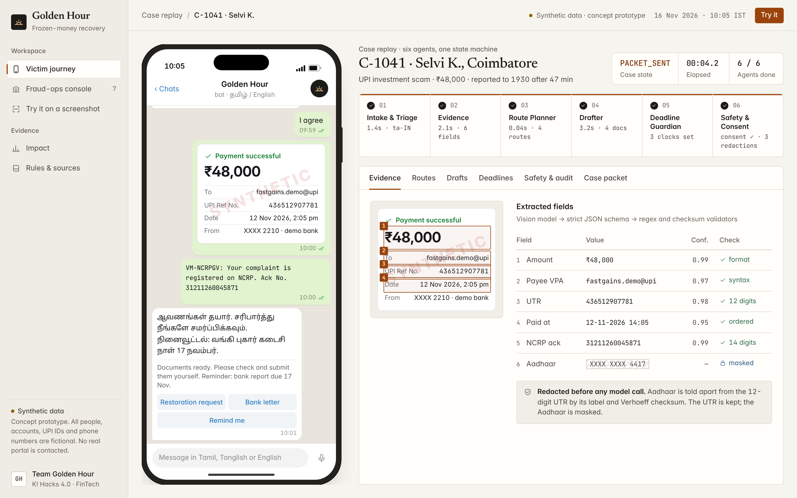
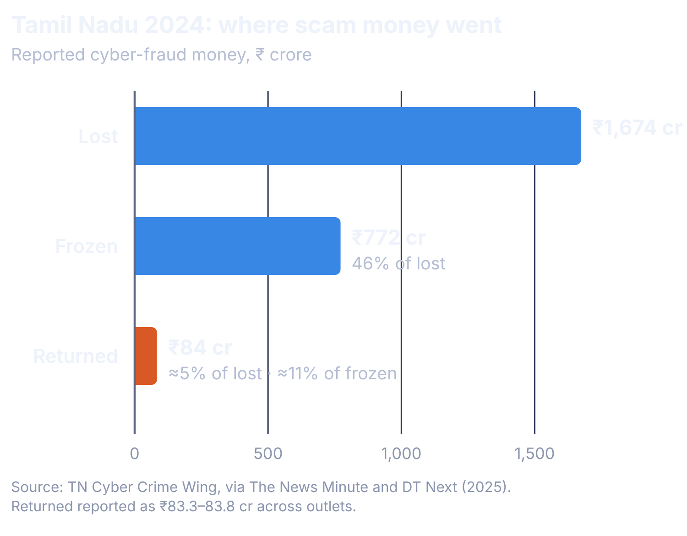
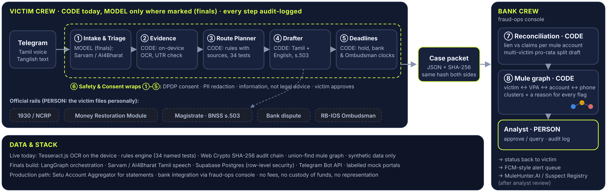
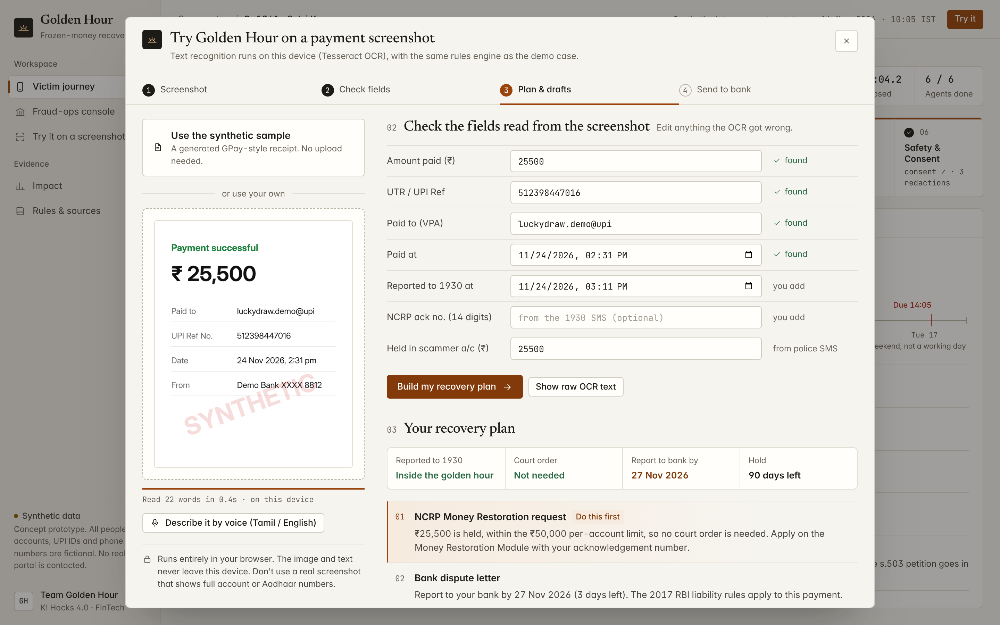
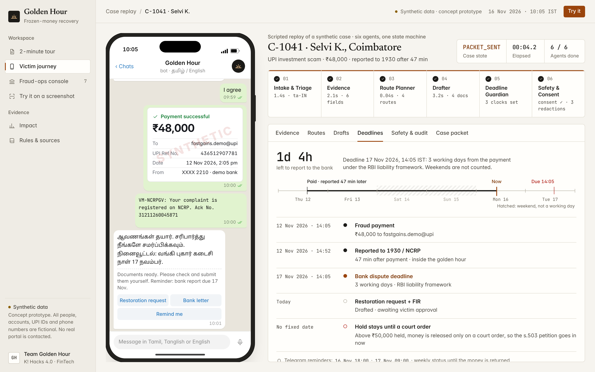
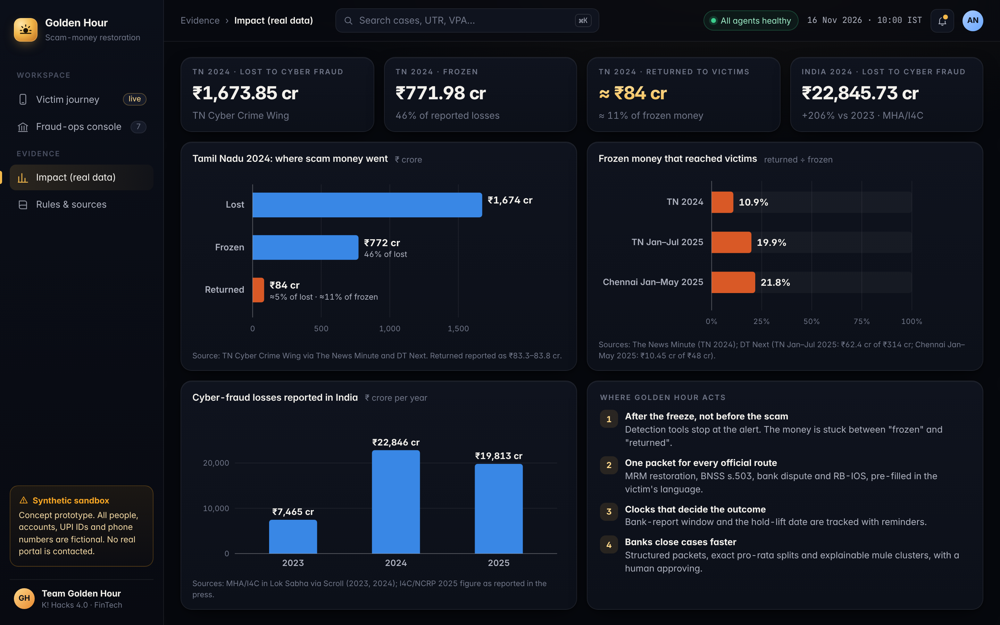

# Golden Hour

**A multi-agent copilot that turns frozen scam money into filed refund claims.**
FinTech track · K! Hacks 4.0 (CEG Tech Forum, Anna University) · Team Golden Hour, Chennai Institute of Technology

**▶ Live demo: [golden-hour-khacks.vercel.app](https://golden-hour-khacks.vercel.app)** · open **Try your screenshot** to run it on your own UPI receipt · [demo video](video/golden-hour-demo.mp4) · 



## Judges: start here (3 minutes)

0. Short on time: open **2-minute tour** in the live demo (8 stills, a captioned video and real sources).
1. Open the **[live demo](https://golden-hour-khacks.vercel.app)** → **Try it live** → **Use our synthetic sample** (or drop in any UPI screenshot; it never leaves your browser).
2. Click **Build my recovery plan**. Change *Held in scammer a/c* to `90000` and rebuild: the plan switches to a BNSS s.503 court petition, because holds above ₹50,000 need a court order.
3. Switch the drafts to **தமிழ்**, then **Save as PDF**.
4. Click **Send case packet to bank desk**: the bank console receives the same packet (same SHA-256 hash) and splits the hold fairly across every victim of that account.

| What | Evidence |
|---|---|
| Rules engine | [`engine.js`](engine.js): every rule value cites its source and is marked *official*, *reported* or *our policy* |
| Tests | **35 named cases** run on every push ([`tests/engine.test.js`](tests/engine.test.js)): ₹50,000 vs ₹50,001, 31 Dec 2026 vs 1 Jan 2027, weekend deadlines, compensation caps, exact pro-rata to the rupee |
| OCR | **60 synthetic receipts** (3 layouts × 4 conditions), English + Tamil model: amount 60/60, UTR 60/60, date 60/60, payee UPI ID 56/60, median 0.3 s per image on-device ([`bench/ocr-bench.json`](bench/ocr-bench.json), `node tools/ocr-bench.js`) |
| Honesty | [What is real and what is scripted](#what-is-real-in-the-prototype) |
| Real-world voices | [`data/evidence.json`](data/evidence.json): 15 quotes from victims, courts and Tamil Nadu police, verbatim with source and date (shown in the app's **Two-minute tour**) |

### Who does what: code, model or person

| Agent | Today in the prototype | In the finals build |
|---|---|---|
| Intake & Triage | Browser speech (`ta-IN`), scripted chat | Model: Sarvam / AI4Bharat Tamil speech |
| Evidence | **Code**: Tesseract OCR + parser, UTR/ack validation, Aadhaar masking | Code + vision model fallback |
| Route Planner | **Code**: deterministic rules with sources | Code (a model never decides the route) |
| Drafter | **Code**: Tamil/English templates | Code templates + model read-back in Tamil |
| Deadline Guardian | **Code**: date rules | Code + reminders |
| Safety & Consent | **Code**: consent, redaction, hash-chained audit | Code |
| Reconciliation (bank) | **Code**: pro-rata split to the rupee | Code |
| Mule-graph explainer (bank) | **Code**: union-find clusters | Code, fed by bank flags (e.g. MuleHunter.AI) |
| Every filing and every bank action | **Person**: the victim files; an analyst approves | Person |

> **Concept prototype for the Round 1 idea submission.** It runs entirely on synthetic data. It does not connect to any real bank, police or government portal. The finals build will be developed during the 24-hour hackathon, as the rules require.

## The problem

When a scam is reported quickly, the money often gets frozen. It rarely comes back.



- **Tamil Nadu 2024:** ₹1,674 cr lost, ₹772 cr frozen, about ₹84 cr returned. That is roughly 11% of the frozen money. *(TN Cyber Crime Wing, via The News Minute and DT Next)*
- **Chennai, Jan–May 2025:** ₹48 cr frozen, ₹10.45 cr returned "after legal processes". *(DT Next)*
- **The victim has to start the restoration.** That means 4+ separate channels, most of them English-first:
  - the MHA SOP (Jan 2026) and the NCRP Money Restoration Module
  - a magistrate petition under BNSS s.503
  - a bank dispute
  - the RBI Ombudsman
- **There is a clock.** For holds up to ₹50,000, the hold lapses after about 90 days if no restoration request or court order arrives. Above ₹50,000 the hold stays, but the money is released only on a court order, so the victim has to file a BNSS s.503 petition.


## The solution

Two crews of agents share one case packet.

**Victim crew** (Telegram, in Tamil, Tanglish or English, voice or text):

1. **Intake & Triage** – speech-to-text in Tamil and Tanglish, then a reply in the victim's language.
2. **Evidence** – turns UPI screenshots, bank SMS and the NCRP acknowledgement into strict JSON. It validates the 12-digit UTR and the 14-digit acknowledgement number, and masks Aadhaar and PAN.
3. **Route Planner** – uses deterministic rules with cited sources to pick the right official route: MRM request, BNSS s.503 petition, bank dispute, or RB-IOS 2026 Ombudsman.
4. **Drafter** – pre-fills the forms, petition and letters, then reads them back in Tamil. The victim reviews and files every document personally.
5. **Deadline Guardian** – tracks the bank-report window, the hold-lift date and the Ombudsman window, and sends reminders.
6. **Safety & Consent** – covers every step: DPDP notice and consent, PII redaction, "information, not legal advice", and a hash-chained audit log.

**Bank crew** (a fraud-ops console):

7. **Reconciliation** – compares the lien against all victim claims on each mule account and drafts a pro-rata split.
8. **Mule-graph explainer** – builds a victim ↔ VPA ↔ account ↔ phone graph, finds clusters with union-find, and states a reason for every flag. A human analyst decides every action.

**Rules it never breaks:** no fees · never holds money · never asks for OTP or PIN · never represents anyone.



## Demo

### Try it on your own screenshot
Open the [live demo](https://golden-hour-khacks.vercel.app) and click **Try your screenshot** in the sidebar. Drop in a UPI payment screenshot, or use the synthetic sample. Golden Hour reads it with real OCR (Tesseract, bundled in `vendor/`) and pulls out the amount, UTR, payee UPI ID and time. You can correct any field, then it builds your recovery plan:

- **Up to ₹50,000 held:** NCRP Money Restoration request, no court order needed.
- **Above ₹50,000 held:** a BNSS s.503 magistrate petition comes first (Madras HC: the NCRP acknowledgement is enough, no need to wait for an FIR), with a s.106(3) notice request and an MRM + FIR filing in parallel.
- **Every case:** a bank dispute letter with its reporting deadline (2017 rules, or the RBI 2027 rules by payment date), RBI small-value compensation where it applies, a 90-day hold countdown and the Ombudsman step.

Each draft (restoration request, s.503 petition, bank letter) is generated **in Tamil and in English**, previewed on screen, and downloadable as text or saved as a PDF. **Send case packet to bank desk** hands the same packet to the bank console, where it joins the hold on the scammer's account.

Measured in headless Chromium on a 4-core test machine: the first read takes about 1.6 s including loading the OCR engine, then about 0.3 s per screenshot. OCR runs on the user's device, so it costs us nothing per case. **Everything runs in your browser and nothing is uploaded.** In Chrome or Edge you can also describe the scam by voice in Tamil or English.




- **Video (125 s, with on-screen captions, no voice-over):** [`video/golden-hour-demo.mp4`](video/golden-hour-demo.mp4)
- **Run it locally:** serve the folder (`python3 -m http.server`) and open `http://localhost:8000`. The scripted walkthrough also works straight from `index.html`, but the OCR worker needs a web server.
  - `index.html?autoplay=1&captions=1` plays the scripted walkthrough with captions.
  - `index.html?view=bank` opens the bank console. Click any case to reconcile its account.
- **Hosted:** every push to `main` deploys to [golden-hour-khacks.vercel.app](https://golden-hour-khacks.vercel.app).

The prototype has four views:

- **Victim journey:** a Telegram conversation in Tamil and Tanglish, plus a live agent pipeline. Its inspector has tabs for Evidence, Routes, Drafts, Deadlines, Safety & audit, and the case packet JSON.
- **Fraud-ops console:** KPIs, the case queue, lien reconciliation and the mule-graph explainer with hover evidence.
- **Impact:** real public data on where Tamil Nadu's scam money went.
- **Rules & sources:** every rule value used by the planners, with its source and whether it still needs checking.

| Victim journey · evidence | Victim journey · deadlines |
|---|---|
|  |  |
| **Fraud-ops console** | **Impact (real data)** |
|  |  |

### What is real in the prototype

These parts are working code:

- **Rules engine ([`engine.js`](engine.js)):** deterministic route planning over the case fields (held amount, report time, payment date), deadlines, and the Tamil/English drafts. Every rule value has a source and a status (official, reported, or our policy), shown in the **Rules & sources** view.
- **Tests ([`tests/engine.test.js`](tests/engine.test.js)):** 35 named cases on routes, deadlines, compensation, the hold rules, pro-rata splits, mule clusters, the receipt parser and the drafts, run on every push. Run them with `node --test tests/engine.test.js`.
- **OCR:** Tesseract in the browser, on real screenshots.
- **Deadline calculations:** working-day arithmetic.
- **Pro-rata lien reconciliation:** rounding is exact to the rupee.
- **Mule clustering:** union-find over graph edges.
- **Audit chain:** each state change is SHA-256 hashed onto the previous block (Web Crypto).

These parts are scripted for the demo:

- **Speech-to-text and vision extraction:** in production they are model calls (Sarvam or AI4Bharat for Tamil speech, a vision LLM for screenshots).
- **Data:** every case, VPA (UPI ID), account and phone number is synthetic and marked as such.

Rule thresholds such as the ₹50,000 SOP limit and the 90-day hold (which applies only to holds up to ₹50,000) are taken from news reports and legal commentary. They must be checked against the official texts before any real use.

## Market


Golden Hour is free for victims. It is a B2B2C product: banks pay per case or per seat for the fraud-ops console and a white-label recovery flow inside their app. Distribution would go through bank-technology partners. A public-good tier is planned for state cyber cells and legal-aid desks.

## Repository layout

| Path | What it is |
|---|---|
| `index.html` | Clickable prototype (victim crew + bank crew) |
| `engine.js` | Rules engine and Tamil/English drafts, shared by the demo and the tests |
| `tests/` | Unit tests (`node --test tests/engine.test.js`) |
| `bench/` | OCR benchmark results (`node tools/ocr-bench.js`) |
| `fonts/` | Inter, JetBrains Mono, Noto Sans Tamil (SIL Open Font License) |
| `video/` | Demo walkthrough (MP4) |
| `screenshots/` | Prototype screenshots |
| `charts/` | Charts built from cited public figures, plus the architecture diagram (`charts.html` is the source) |
| `deck/` | Round 1 submission deck in two versions, text-only and with visuals, plus PDF previews |
| `vendor/tesseract/` | Tesseract.js 5.1.1 and the English model, self-hosted for in-browser OCR (Apache-2.0) |
| `tools/` | Playwright scripts that regenerate the screenshots, video and charts |

To regenerate the assets, install Node 18+ and run `npm i playwright`. Then run `node tools/shot.js`, `node tools/record.js` or `node tools/charts.js`. To convert the recorded WebM to MP4:

```bash
ffmpeg -i video/raw/*.webm -c:v libx264 -pix_fmt yuv420p video/golden-hour-demo.mp4
```

## Sources

1. The News Minute / DT Next – TN Cyber Crime Wing 2024 figures (lost, frozen, returned)
2. DT Next – Chennai Jan–May 2025: ₹48 cr frozen, ₹10.45 cr returned; TN Jan–Jul 2025: ₹1,010 cr lost, ₹314 cr frozen, ₹62.4 cr refunded
3. Scroll – MHA/I4C in Lok Sabha: ₹7,465 cr (2023) → ₹22,845.73 cr (2024) lost to cyber fraud
4. MHA SOP for NCRP-CFCFRMS (02.01.2026); Business Standard (Jan 2026)
5. MHA / I4C SOP (02.01.2026): s.106(3) notice route, 90-day hold with one extension; Madras HC circular on s.503 release without an FIR (DT Next)
6. RBI customer-liability circular (6 Jul 2017) and Third Amendment Directions (24 Jun 2026, effective 1 Jan 2027); RB-IOS 2026
7. RBI Ombudsman Annual Report 2024-25

## Third-party software

| Component | Licence |
|---|---|
| Tesseract.js 5.1.1 (`vendor/tesseract/`) | Apache-2.0 |
| Tesseract English and Tamil models from `tessdata_fast` (`vendor/tesseract/lang/`) | Apache-2.0 |
| Inter, JetBrains Mono, Noto Sans Tamil, Newsreader (`fonts/`) | SIL Open Font License 1.1 |
| Playwright (dev tools only) | Apache-2.0 |

All other code in this repository was written by the team for K! Hacks 4.0.

## Team

| Role | Name | College |
|---|---|---|
| Lead · Agents & Rules (rules engine, tests, OCR) | Mahak Fahad | Chennai Institute of Technology (B.E. CSE, 2nd year) |
| Frontend & UX (demo UI, Tamil drafts, video) | Roshini R | Chennai Institute of Technology (B.E. CSE, 2nd year) |
| Bank side & Data (console, OCR benchmark, deployment) | Kanish Karthikeyan | Chennai Institute of Technology (B.E. CSE, 2nd year) |
| Research & Pitch (legal research, deck, user validation) | Annika Meril | Chennai Institute of Technology (B.E. CSE, 2nd year) |

*Golden Hour gives information, not legal advice. Victims review and file every document themselves.*
